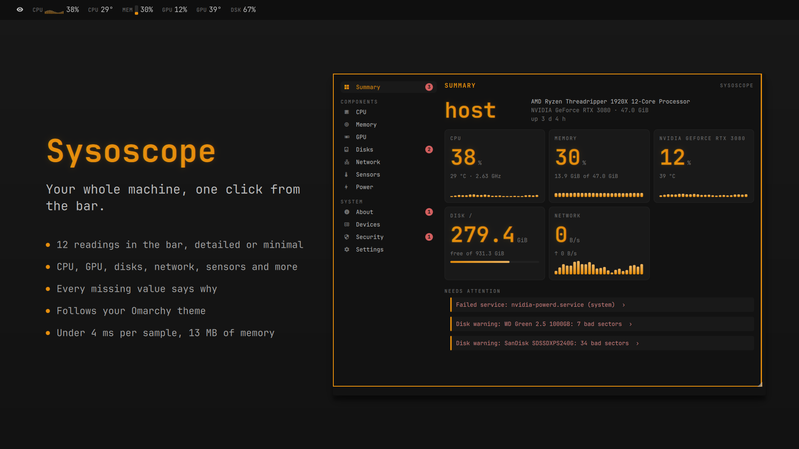
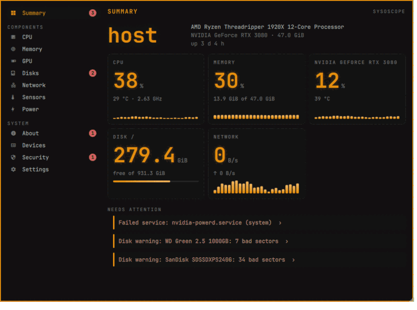

# Sysoscope

Your hardware and what it is doing right now, in the
[Omarchy](https://omarchy.org) bar: CPU, memory, GPU, disks, network, sensors
and power at a glance, and a full inventory one click away. Measured, private
and light.



Sysoscope brings together two Omarchy plugins,
[Argus](https://github.com/diegopluna/omarchy-argus) (live monitoring) and
[Hardware Details](https://github.com/gladimdim/omarchy-hardware-info-plugin)
(inventory), behind one small collector.

## Install

```sh
omarchy plugin add https://github.com/FerC10110/omarchy-sysoscope.git --enable
```

`--enable` also puts it on the bar. To move it later, use
`omarchy bar move io.github.ferc10110.sysoscope --section left` (or `center`,
`right`). The collector ships inside the plugin, for
`x86_64` and `arm64`; there is nothing else to install. `nvidia-smi`,
`udisks2`, `inxi`, `iw` and `fwupdmgr` are used when present (see
[the collector](#for-developers-the-collector)).

It adds two entries to the launcher (SUPER+SPACE): **Sysoscope** opens the
panel and **Sysoscope (terminal)** opens its tab in lazylazy.

To remove it: `omarchy plugin remove io.github.ferc10110.sysoscope`. This
version installs nothing privileged, so there is nothing else to undo. Its
files are `~/.config/sysoscope/config.json`, `~/.local/state/sysoscope/`
(the history), `~/.cache/sysoscope/` and the two launcher entries,
`~/.local/share/applications/io.github.ferc10110.sysoscope.desktop` and
`io.github.ferc10110.sysoscope-terminal.desktop` (removed when the plugin is
disabled or removed; an entry of your own at those paths is never touched).
When you press `P` on Power it also writes Omarchy's own saved profile,
`~/.local/state/omarchy/powerprofiles/ac` or `battery`.

## The bar

By default the bar shows CPU usage and temperature, memory, and, when there
is a graphics card, its usage and temperature (plus the battery on a laptop).
Each metric can be turned on or off, reordered and drawn in one of four
styles: `icon`, `value`, `spark` (a small sparkline of the last minutes) or
`gauge`.

| Metric | Opens | Urgent from |
|---|---|---|
| CPU, CPU temperature, load | CPU | 90 %, 85 °C |
| Memory | Memory | 90 % |
| GPU, GPU temperature, VRAM | GPU | 95 %, 85 °C, 90 % |
| Disk `/`, disk activity | Disks | 90 % |
| Network | Network | |
| Battery, power profile | Power | below 15 % |

A metric over its threshold turns the urgent colour. A metric can also be set
to appear only then, so the bar stays quiet until something needs you. Hover a
metric for its value, its peak and its sparkline, with the readings next to it
(the CPU's temperature and clock, the memory in bytes, the upload).

Settings → Bar look switches between the detailed bar (small tags, columns and
gauges) and the minimal one (icon and value).

- **Left click** on a metric opens its section; on the icon, the Summary.
- **Middle click** refreshes everything now.
- **Right click** opens `btop`.

A ❄ with a number shows apps you froze; its tooltip says how long until each one resumes.

## The panel



A sidebar with the Summary, the components (CPU, Memory, GPU, Disks, Network,
Sensors, Power) and the system (About, Maintenance, Applications, Devices, Security), plus Settings. A
number next to a section counts what needs attention there: a failed
service, a disk with bad sectors, a vulnerable CPU, a firmware update, a restart after an update, a process
killed for lack of memory.

- **Summary**: the machine in six lines, the cards you choose (CPU, memory,
  GPU, disk, network, power, load…) and everything that needs attention, each
  item linking to its section.
- **CPU**: model, caches, clocks, load, pressure and a map of every core,
  grouped by CCX.
- **Memory**: usage, breakdown, swap and zram, and the modules in each slot.
  How many processes were killed for lack of memory since boot, with their
  names (by the kernel or by `systemd-oomd`); the Summary warns when the
  kernel killed any.
- **GPU**: usage, VRAM, temperature, power, clocks, PCIe link and the
  processes using it. A laptop's sleeping GPU is not woken up to be read.
- **Disks**: each disk with its SMART health, and the filesystems.
- **Network**: traffic, gateway, DNS and every interface. Each Wi-Fi card
  says whether it is on and what it is connected to, and lists the nearby
  networks (signal, band, security, saved or connected). Pick one with
  `j`/`k`: `c` connects (a new network with a password opens `nmtui`, so the
  password never goes through Sysoscope), `d` disconnects, `x` forgets it.
  `w` turns the Wi-Fi on or off, `s` searches again and `b` pins the band
  (with `omarchy-network-band`). Hidden networks (the ones that do not
  announce their name) are listed last, one per access point (BSSID), as
  "(hidden network)"; `c` on one asks for its name in a terminal and joins it
  with `nmcli`, which asks for the password there; `d` disconnects a
  connected one. Needs NetworkManager. A
  card NetworkManager does not manage says "Not managed by NetworkManager": no
  nearby list, no row actions.
- **Sensors**: every temperature, fan and voltage the kernel knows.
- **Power**: power profile, batteries (health, cycles, charge limit) and the
  measured draw. `p` changes the power profile with
  `omarchy-powerprofiles-set`, which remembers it for plugged in or on
  battery; on a laptop, `P` saves the profile for the other power source
  without changing the current one, and a row shows both.
  It also shows what keeps the computer or the screen awake, read only
  while Power is open: programs that block or delay sleep through logind,
  windows that keep the screen on (a fullscreen video, or `i` on
  Applications) and Omarchy's "stay awake"; how it suspends (suspend to RAM
  or modern standby, from `/sys/power/mem_sleep`) and which devices can wake
  it (USB devices and network cards).
- **About**: the system, the date and time (time zone, automatic sync,
  whether the clock is synchronized), packages, boot times, failed services
  and firmware. The Summary warns when the time is not set automatically or
  the clock is not synchronized.
- **Maintenance**: whether you need to restart to use what was updated (the
  same rules as `omarchy update`: the running kernel no longer installed,
  Omarchy's restart flag, Hyprland replaced, a new NVIDIA driver not loaded
  yet), the last full system update and package change (from
  `/var/log/pacman.log`), the disk space used by caches (pacman, yay, paru,
  the journal and crash dumps) with the command to free each one (Sysoscope
  never runs it), and your btrfs snapshots from snapper, or the one command
  that lets your user see them. `u` checks the official repositories for
  updates with `checkupdates`; the AUR is never asked. The Summary warns
  when a restart is needed, after more than 30 days without a full update,
  and when a check found updates.
  Its Health group shows this boot's errors in the journal (how many, which
  programs logged the most, the latest five), the programs that crashed in
  the last 7 days (run `coredumpctl info <PID>` to see why) and the
  processes killed for lack of memory. Errors and crashes never warn: they
  are read only while the section is open, every 30 seconds. Kills by the
  kernel do warn in the Summary (see Memory), since their count is read on
  every sample.
- **Applications**: each app with its windows (workspace, monitor, floating,
  pinned, fullscreen…), what it uses (CPU, memory, GPU, TCP network, disk) and the
  heaviest apps without a window. Pick a window with `j`/`k` and act on it:
  go to it, float, pin, fullscreen, move to a workspace or monitor, center,
  resize, group, keep the screen on, capture it, close it; or on the whole app:
  open it in btop, freeze it for 5 minutes, force-close it. Hyprland, the shell,
  PipeWire, Xwayland, uwsm, hyprlock, the session's own services (windowless
  processes in `session.slice` or the login scope) and Sysoscope's own parents
  are never frozen or closed. Network per
  app counts TCP only (QUIC and UDP are not included). Disk per app is
  what each app reads from and writes to the disk per second: reads served
  from memory are not included, and a write counts for the app that made
  it even if the kernel writes it to the disk a bit later.
- **Devices**: PCI, USB, Bluetooth, monitors and audio.
  Monitors show the mode in use from Hyprland (resolution, refresh rate,
  scale, VRR, color) and the best refresh rate the monitor offers at that
  resolution; over HDMI, a line says when the monitor declares more than
  that input offers. USB devices show their USB version. The Summary warns
  when a monitor runs below a refresh rate it offers at the same resolution
  and when a USB 3 device runs at USB 2 speed.
  The audio outputs
  and inputs (read with `pactl` only while Devices is open) show their
  volume, whether they are muted and which is the default: `d` makes one
  the default (with Omarchy's `omarchy-audio-output-set-default`, which also
  moves what is playing), `m` mutes or unmutes it, `+`/`-` change the volume
  by 5 and `v` sets it. Bluetooth shows whether it is on and each device
  (connected, paired, or nearby from an earlier search): `b` turns it on or
  off, `e` opens Omarchy's Bluetooth panel to pair a device, and on a paired
  one `c` connects, `x` disconnects and `f` forgets it. These run
  `omarchy-bluetooth-*` in the background and write whether they worked to
  `actions.log` (without the device's name or address).
- **Security**: which programs are using the camera and the microphone; what
  listens on the network (every port, whose it is and how far it reaches:
  this computer only, the local link, one interface or every network) and,
  for what reaches every network, whether the firewall lets it in; whether
  the firewall (ufw, or firewalld/nftables/iptables) is on and ufw's rules;
  which disks and swaps are encrypted; Secure Boot, TPM, CPU features and
  vulnerabilities. The Summary warns when a TCP service listens on every
  network and nothing filters it (the firewall is off, or ufw is on with an
  incoming policy of ACCEPT), when ufw is enabled but `ufw.service` is not
  running, and when a swap is not encrypted while the system disk is.

Drag the panel's bottom-right corner to resize it and its title to move it;
both are remembered. Settings → Panel size puts it back to automatic.

| Keys | |
|---|---|
| `j` `k` / arrows | previous / next section |
| `1`–`9` | go to a section |
| a letter | the next section that starts with it |
| `/` | filter the sections and search the content of every section: the arrows go through both, Enter opens a result (and picks its row) |
| `r` | refresh now |
| `f` | on About: check firmware updates |
| `u` | on Maintenance: check for updates (official repositories only) |
| Enter | on Summary: follow the first warning |
| `j` `k` | on Applications: pick a window; `h` `l` change section |
| Enter, `t` `p` `f` `m` `w` `W` `s` `o` `c` `z` `u` `a` `b` `i` `L` `x` | on Applications: act on the window (the footer lists them) |
| `K` `F` `B` | on Applications: force-close, freeze/resume or open in btop the whole app |
| `j` `k`, `c` `d` `x` | on Network: pick a Wi-Fi network; connect, disconnect or forget it (on a hidden network, `c` asks for its name, and `d` if it is connected; no `x`) |
| `w` `s` `b` | on Network: Wi-Fi on/off, search for networks, pin the band |
| `p` `P` | on Power: change the power profile; on a laptop, save the profile for the other power source |
| `j` `k`, `d` `m` `+` `-` `v` | on Devices: pick an audio output, input or Bluetooth device; on an audio row, make it the default, mute it, volume up or down, set the volume |
| `b` `e`, `c` `x` `f` | on Devices: Bluetooth on/off, pair a device (Omarchy's panel); on a paired device, connect, disconnect or forget it |
| Esc | close |

### Settings

The Settings section changes everything without editing files: which metrics
the bar shows and how, their thresholds, the Summary cards, °C or °F, how
often to sample (2 s by default), the period of the charts (2 minutes, 1 hour,
24 hours or 7 days) and the language. It also shows what the collector costs
on your machine.

The language is shared with the other plugins that use
`~/.config/omarchy/plugin-language.json` (English and Spanish).

### IPC

```sh
omarchy-shell io.github.ferc10110.sysoscope toggle
omarchy-shell io.github.ferc10110.sysoscope open gpu     # or any section id
omarchy-shell io.github.ferc10110.sysoscope refresh
omarchy-shell io.github.ferc10110.sysoscope span 24h     # 2m, 1h, 24h or 7d
omarchy-shell io.github.ferc10110.sysoscope metrics      # the bar's values as JSON
omarchy-shell io.github.ferc10110.sysoscope ping         # "ok" while the plugin is loaded
```

## In lazylazy

With [lazylazy](https://github.com/FerC10110/lazylazy) installed, Sysoscope adds
a **System** tab: the same sections as the panel, as text. It reads the panel's
units and summary cards. The tab is declared in `lazylazy.toml` and served by
`sysoscope lazylazy`.

`lazylazy sysoscope` opens lazylazy on this tab (the launcher entry
"Sysoscope (terminal)" does just that).

In Applications the keys are the panel's, except go to window, which is `g`
(Enter is lazylazy's own). lazylazy shows every action on every row: `K` and `F`
also appear on protected apps (Hyprland, the shell, the session), and the
collector refuses them there with the reason.

In Network, `c` runs in lazylazy's full screen: a saved or open network
connects in the background, a new one with a password opens `nmtui` right
there, and a hidden one asks for its name right there (from the panel, in a
window of its own that waits for Enter before closing). lazylazy shows every Wi-Fi action on every network; the collector
refuses the ones that do not apply (disconnecting a network that is not
connected, forgetting one that is not saved) with the reason.

In Devices, lazylazy shows every audio and Bluetooth action on every row:
the collector refuses an audio action on a Bluetooth device, and the other
way round, with the reason. `v` starts empty there (in the panel it starts
at the row's volume).

In Maintenance, `u` runs in lazylazy's full screen and prints the list of
updates; the panel shows the same result.

## What it costs

Measured on a 24-thread desktop with an NVIDIA card, sampling every 2 s,
counting the collector and the commands it runs and waits for: 5.3 ms of CPU
per sample on average with the panel closed, and 12–15 MB of memory. With an
NVIDIA card, the `nvidia-smi` loop that keeps running in the background is not
in that number: it adds about 1.3 ms of CPU per second (~2.6 ms per sample),
so about 8 ms per sample in total, about 0.4% of one core.
Reading every process for the apps costs about 5 ms (mostly the kernel
producing `/proc`), so it only happens while a view that shows apps is open:
every 2 samples on Applications and every 5 on CPU, Memory, GPU and Network.
Those views also run `ss` (about 44 ms of CPU each time) and, with an NVIDIA
card, `nvidia-smi pmon` (about 57 ms) every 5 samples for the network and GPU
per app, so with them open a sample costs 43 ms on average on Applications and
33 ms on Memory. On Applications, each of those reads also reads
`/proc/<pid>/io` of your own processes that used CPU (or collected a finished
child) since the last read, for the disk per app: 0.9 ms more per read (154
processes here, about a quarter of them read each time), about 0.4 ms per
sample; the other views never read it. I/O done by a process that used no CPU
is not lost: it shows up at the process's next real read, possibly several
samples later, all in that one interval, whose rate reads high. The other
slower sources run at their own pace, and firmware checks run in the
background so they never hold up the bar. The first sample
reads the whole inventory once (about 100–150 ms) and is left out of the
average that Settings shows. With Network open, the Wi-Fi read runs `nmcli`
every 10 seconds in the background: about 10 ms of CPU per sample on
average, measured with the Wi-Fi radio off (both cards soft-blocked, as on
this machine today). With the radio on, each powered card adds one `nmcli
device wifi list` to that read, so the real cost is higher; not measured
here.
With Devices open, each sample also runs `pactl` three times (outputs,
inputs and defaults) and reads Bluetooth from D-Bus: about 25 ms of CPU
per sample on average on this machine. Omarchy's availability script runs
the first time, when the outputs or their ports change, and after making a
device the default (`d`); it does not run again for mute, volume or the
other audio keys, even held down.
A content search (`/` in the panel, 150 ms after you stop typing) builds
every section's view from the last sample in memory, without reading
anything: about 0.7 ms per search on this machine.
Maintenance adds, with the panel closed, a few file checks once a minute
(restart needed, NVIDIA, `pacman.log` only when it changed): 5.1 ms per
sample on average against 4.9 ms before. With Maintenance open, a sample
costs 5.3 ms on average; opening the section itself costs about 13.5 ms more
than opening About, which is not only the caches walk (every 10 minutes in
the background) but also that first sample's `journalctl --disk-usage` and
reading the snapper configs.
Health on Maintenance runs `journalctl` twice and `coredumpctl` once every
30 seconds while Maintenance is open (and the kernel's journal only if it
killed something): 5.5 ms per sample on average against 5.5 ms before.
On Memory only the `systemd-oomd` part runs: 35.7 ms against 36.8 ms. With
the panel closed, each sample only adds one read of `/proc/vmstat`: 5.5 ms
against 5.2 ms. The "before" numbers in this paragraph were measured again,
with the previous binary, in the same session as the new ones (averages of
three interleaved pairs), so they differ a little from the figures in the
Maintenance paragraph above, measured on another day.
Security adds, with the panel closed, once a minute, a query to the kernel
for the TCP ports that listen (netlink `sock_diag`, which is much cheaper
than `/proc/net/tcp`: that file walks every connection of the machine), two
small files from `/proc/net` for UDP and a `stat` of ufw's files (the
firewall's units come in the same systemd call as the clock): 5.3 ms per
sample on average against 5.3 ms before. With Security open, the ports are
read when it opens and every 5 samples, and the open files of your
processes are walked (about 57 ms each time) only when a new port of yours
appears or, if the machine has a camera, every 5 samples, in the same pass
that looks for the camera: 5.8 ms per sample on average against 5.6 ms
before.
With Power open, each sample also asks logind for its inhibitors (one
D-Bus call), Hyprland for its windows (one socket request) and checks
Omarchy's stay-awake file: 8.6 ms per sample on average against 7.3 ms
before. The monitors' mode in use comes from Hyprland's socket with the
slow sources and every 5 samples with Devices open (30.8 ms against 29.9
ms with Devices open, within the noise between runs); with the panel closed a sample costs 6.2 ms against
6.3 ms before.

## Privacy

Everything stays on your machine. The collector itself makes no network
requests. The one exception is the firmware check: pressing `f` on About (or
`snapshot --section firmware`) runs `fwupdmgr get-updates`, which may contact
the LVFS firmware service. Later versions add two more things that go online,
each only when you ask and with a notice first: your public IP and a speed
test.

`u` on Maintenance runs `checkupdates` (from `pacman-contrib`), which
downloads the package lists from your pacman mirrors into its own folder;
the mirror sees your IP address, as with `pacman -Sy`, and nothing about
your installed packages is sent. It only runs when you press `u`, and the
section says so before. The AUR is never asked (that would send the names
of your AUR packages to aur.archlinux.org). The result is kept in
`~/.cache/sysoscope/updates.json`. Snapshots: snapperd is asked only if
snapper's config already lets your user see them, and only when you open
Maintenance or press `r`.

The journal's error messages, the programs that crashed and the processes
killed for lack of memory are read only while Maintenance is open (the last
ones also on Memory), with `journalctl` and `coredumpctl`, and are never
written to disk.

The Wi-Fi networks come from NetworkManager (`nmcli`) and are read only while
the Network section is open, every 10 seconds; `s` asks the card to scan,
which stays on your machine. Sysoscope never asks for, sees or stores a
Wi-Fi password: a new network that needs one is joined in `nmtui`, and for a
hidden network `nmcli` reads the password straight from the terminal. The
name you type for a hidden network goes to `nmcli` as is and is not kept
anywhere either. Every Wi-Fi action is written to `actions.log` in
Sysoscope's state folder: which action, when and whether it worked, with no
password and no network name.

The audio devices come from PipeWire (`pactl`) and are read only while the
Devices section is open. Bluetooth is read from BlueZ over D-Bus, and only
if it is already running. Every audio and Bluetooth action is written to
`actions.log` the same way, without the device.

The camera and microphone check reads which programs have them open. It only
runs while the Security section is open, and the same pass finds which of
your programs owns each port that listens (other users' programs show only
their system user, from `/etc/passwd`). The listening ports, the firewall's
files and the disk encryption are read on your machine once a minute (the
ports every 10 s while Security is open); none of it is sent anywhere.

The windows that keep the screen on (their class and title) and the programs
that ask logind to delay or block sleep (and why) are read only while Power
is open.

**What is written to disk.** The panel gets everything live, over the
collector's output; nothing that identifies your computer, you or what you
are doing is written to disk. `latest.json` (the last snapshot, in
`~/.local/state/sysoscope/`, so the command line can reuse it) leaves out:
window titles; the inhibitors' program and reason, and the class and title
of the windows that keep the screen on; the serial numbers of disks and
monitors; MAC addresses (also inside the names of Bluetooth devices'
batteries, and interface names made from one, like `wlx…`, which become
`wlx1`); the hostname; user names (yours shows as
`~` in paths) and the users allowed to see snapshots; Wi-Fi network names,
BSSIDs and saved-connection ids; Bluetooth device names and addresses;
PipeWire device names (they carry USB serials or Bluetooth addresses);
disk and partition UUIDs; public IPv4 addresses and every IPv6 address
except loopback (also among the sources ufw lets in to a port); and the journal's errors, crashes and processes killed for
lack of memory. Device and program names, private IPv4 addresses (your
local network), versions and every number are kept. The inventory cache
(`~/.cache/sysoscope/static.json`) keeps neither the hostname nor the
monitors' serial numbers: they are read again when the collector starts
(an older cache that has them is rewritten). `actions.log` notes which
action ran, when and whether it worked, but not the network, Bluetooth or
audio device it was for, nor what a window action answered (it names the
window). The history keeps only numbers.

## For developers: the collector

`sysoscope` is a single static binary (Go, no cgo) for `linux/amd64` and
`linux/arm64`. The binaries in `bin/` are rebuilt from source and compared byte by
byte on every push; [BINARY_PROVENANCE.md](BINARY_PROVENANCE.md) says how to
check them yourself and everything the program reads, runs and writes. It reads `/proc`, `/sys` and D-Bus, and runs a few optional
tools. None of them is required: when one is missing, the snapshot says what
is missing and why, instead of failing.

| Optional | Used for |
|---|---|
| `nvidia-smi` | NVIDIA GPU usage, VRAM, power and clocks |
| `udisks2` (D-Bus) | SMART health of disks, without root |
| `power-profiles-daemon` (D-Bus) | the active power profile |
| `omarchy-powerprofiles-set`, `powerprofilesctl` | changing the power profile (`p`/`P` on Power) |
| `systemd-timesyncd` (its unit, via `org.freedesktop.systemd1`) | automatic clock sync on About (the time zone comes from `/etc/localtime`, the sync state from the kernel) |
| `inxi` | memory module details |
| `iw` | the Wi-Fi network name |
| `fwupdmgr` | firmware versions; updates only on request |
| `checkupdates` (`pacman-contrib`) | updates from the official repositories, only when you press `u` on Maintenance |
| `journalctl` | on Maintenance: the journal's disk usage, this boot's errors and the processes killed for lack of memory (these also on Memory) |
| `coredumpctl` | programs that crashed in the last 7 days, on Maintenance |
| snapper (`org.opensuse.Snapper`, D-Bus) | btrfs snapshots on Maintenance, only if its config allows your user |
| `nmcli`, `nmtui` (NetworkManager) | nearby Wi-Fi networks and the Wi-Fi actions |
| `rfkill` | turning on a Wi-Fi card that is still blocked |
| `omarchy-network-band`, `omarchy-launch-tui` | pinning the Wi-Fi band; `nmtui` from the panel |
| `pactl` (PipeWire) | audio outputs and inputs on Devices, and their actions |
| `omarchy-audio-sink-availability`, `omarchy-audio-output-set-default`, `omarchy-audio-input-set-default` | hiding unusable outputs like the bar; making one the default and moving what plays |
| `omarchy-bluetooth-power`, `omarchy-bluetooth-device`, `omarchy-shell` | the Bluetooth actions on Devices |
| `ufw` (its files in `/etc/ufw` and `/etc/default/ufw`), `firewalld`, `nftables`, `iptables` (their units, via `org.freedesktop.systemd1`) | the firewall on Security (`ufw status` is not used: it needs root) |
| logind (`org.freedesktop.login1`, D-Bus) | what keeps the computer or the screen awake, on Power |

### Commands

```
sysoscope snapshot [--section S] [--pretty] [--lang en|es]
    Print one snapshot as JSON. For cpu, memory, gpu, sensors and self it
    reuses the running stream's latest.json when it is less than 5 seconds
    old; everything else takes a snapshot (latest.json leaves out what
    identifies the computer: see Privacy).

sysoscope stream [--interval 2s] [--lang en|es] [--units c|f] [--cards a,b]
    Print one JSON snapshot per line (NDJSON). Each line also carries
    "sections" (the panel's sidebar, with badges) and, when a view is
    focused, "view". Reads commands on stdin:
    interval N | focus [VIEW] | pause | resume | refresh | quit
    lang en|es | units c|f | cards a,b,c | action firmware.check | action updates.check
    action ID ["ROW","INPUT"] (answered by a "result" on the next line)
    search "QUERY" (a JSON string; answered right away by a line that
    carries "search": {"query", "hits"})

sysoscope view VIEW [--lang en|es] [--units c|f] [--cards a,b] [--pretty]
    Print one view of the panel as JSON: a list of blocks (key/value
    rows, meters, sparklines, tables, texts, groups, core maps, headline
    numbers (stat), cards and section headers (hero)) that
    the panel and lazylazy draw as they are.

sysoscope search QUERY [--lang en|es] [--units c|f] [--pretty]
    Search the content of every section but Summary (block titles,
    key/value rows, table cells, headline numbers and texts), ignoring
    case and accents, and print {"query", "hits"}: up to 50, each with
    its section, the path of block titles, the text and, for a row you
    can pick in the panel, its row id. Queries shorter than 2 letters
    find nothing.

sysoscope action ID [ROW] [INPUT]
    Run one action and print its result: window.* on a window row
    (0x…:<stableId>, or just the address 0x…), app.* on an app row
    (app:<ID>) or wifi.* on a network row (<iface>:<ssid>, or
    <iface>:hidden:<BSSID> for a hidden network). wifi.radio,
    wifi.rescan and wifi.band act on the whole section and take no row:
    action wifi.band 5. So do power.profile (set the power profile) and
    power.profile_other (save the profile for the other power source):
    action power.profile balanced. On Devices, audio.default,
    audio.mute, audio.up, audio.down and audio.volume act on an output
    or input by its pactl name (action audio.volume <name> 40), and
    bt.connect, bt.disconnect and bt.forget on a Bluetooth device by its
    address; bt.power and bt.pair take no row. Exits 1 on error, with
    the reason.

sysoscope wifi-hidden [--hold] [--lang en|es] IFACE BSSID
    Ask for the name of a hidden network and join it with
    `nmcli --ask … hidden yes`, which asks for the password in the terminal.
    An empty name or Ctrl-C cancels. --hold waits for Enter before closing
    (the panel runs it in a window of its own). The BSSID only picks the
    network: it is not passed to nmcli, so the saved network is not tied to
    one access point and can roam between the radios of a dual-band router
    or a mesh. Exits 0 when connected, 1 when not, 2 on bad usage, 3 when
    cancelled.

sysoscope sections [--lang en|es]
    Print the panel's sections, with the number of things that need
    attention in each.

sysoscope history --metric M [--span 24h|7d|30d] [--format csv|json]
    Export the history of one metric (cpu.usage, cpu.temp, mem.used_pct,
    gpu.usage, net.rx, …; run it without --metric for the full list).

sysoscope fixture capture --out DIR [--anonymize]
    Save what the collectors read, to contribute a test machine.

sysoscope version
```

Sections: `cpu memory gpu storage network sensors power system firmware self maintenance security`.

Views: `summary cpu memory gpu storage network sensors power about maintenance
apps devices security`. Summary cards: `cpu cputemp memory gpu gputemp storage network
power load` (default `cpu,memory,gpu,storage,network`).

Firmware updates are checked in the background (`action firmware.check`, or
`snapshot --section firmware`), so a slow `fwupdmgr` never holds up a sample.
With the Security view open, the collector also reads which programs are
using the camera or the microphone, and which of your programs own the
ports that listen; `snapshot --section security` does the same.
`snapshot --section power` reads what keeps the computer awake itself (it
asks logind and Hyprland once), and `sysoscope view power` always reads it.
Updates are checked the same way (`action updates.check`, or `sysoscope
lazylazy action updates.check`, which prints the list); `snapshot --section
maintenance` measures the caches and reads the snapshots first.

`SYSOSCOPE_LANG` is internal: `wifi.connect` and `wifi.band` finish in a
detached `wifi-wait` process, and the Bluetooth actions in a detached
`bt-wait`, and this is how they get the language their `actions.log` line
is written in. Whichever process changes the language sets it, and every
`sysoscope` process reads it at startup; there is no need to set it by
hand.

The collector is built to stay out of the way. On a 24-thread desktop with an
NVIDIA card, `stream` at 2 s uses about 4.3 ms of CPU per sample and 12 MB
of memory. Expensive sources run at their own pace: sensors every 3
samples, network identity every 5, applications only with a view that shows
them (every 2 samples on Applications, every 5 on CPU, Memory, GPU and
Network), packages and devices every minute.

The history lives in `$XDG_STATE_HOME/sysoscope/`. It keeps the peak of each
interval: 24 hours at 1 minute, 7 days at 10 minutes and 30 days at 1 hour.

### JSON format

Every snapshot has `"schema": 1`. The types, with a comment per field, are in
[`collector/internal/model/model.go`](collector/internal/model/model.go).
Fields the machine cannot provide are omitted or `null`, and each gap is
listed in `unavailable` with a reason (`missing_tool`, `permission`,
`not_present`, `timeout` or `error`) and a message in the snapshot's language:

```json
{"what": "power.rapl", "reason": "permission",
 "message": "permission denied: locked by the kernel; can be unlocked from Settings (stage E)"}
```

Messages are in English or Spanish, picked from `LANG` or `--lang`.

### Screenshots of the panel

`tools/shots` draws the real panel and bar offscreen from saved views, with no
shell running, so a change can be looked at in every section and theme:

```sh
(cd collector && SYSOSCOPE_SHOTS=/tmp/shots go test ./internal/view -run TestWriteShots)
tools/shots/shoot.sh /tmp/shots/threadripper-en dark cpu /tmp/shots/cpu.png
tools/shots/shoot.sh /tmp/shots/threadripper-en light bar /tmp/shots/bar.png both
```

See `tools/shots/README.md` for the themes and the sections.

## Contributing a machine

Test fixtures are real machines, anonymized. To add yours:

```sh
sysoscope fixture capture --out my-machine --anonymize
```

This copies the files the collectors read (the list is `Globs` in
[`collector/internal/fixture/capture.go`](collector/internal/fixture/capture.go)),
plus the output of the commands they run and the D-Bus answers they get. With
`--anonymize`, these are replaced before anything is written:

- MAC addresses (also inside file names), serial numbers and UUIDs
- the hostname, your user name and your home directory
- IP addresses, moved to documentation ranges
- Wi-Fi network names and DNS search domains
- Bluetooth device names (also in the audio devices `pactl` lists)
- the time zone (set to UTC)
- the names of installed packages and flatpaks (only their number is kept),
  except `omarchy*` (its version shows in About) and
  `nvidia(-<branch>)-utils-<version>` (compared with the loaded driver in
  Maintenance) — those two package names are kept on purpose
- `pacman.log`: only the dates (also converted to UTC), what happened and
  the number of packages are kept (package names become pkg1, pkg2…; no
  versions or commands); a log over 2 MiB is not skipped, since the
  reduction is small either way
- `pacman.conf`: reduced to the `[options]` section and its `CacheDir`
  lines, the only thing Maintenance reads — never a `Server` line, which
  can carry credentials for a private mirror
- journal error messages become "message 1", "message 2"… (the source that
  logged each one, its priority and time are kept); a program name — the
  journal's source, a crashed program, or the program or unit that was
  killed for lack of memory (the victim; "kernel" and "systemd-oomd", the
  killers, stay as they are) — becomes prog1, prog2… stable through the
  whole capture, except "kernel" (that one names the journal's source, not
  a program)
- a crashed program's path is reduced to "/progN", with no directory at all
  (only the file name is ever read; an empty one stays empty); a
  `systemd-oomd` kill keeps only the generic slices at the start of its
  cgroup path (`-.slice`, `user.slice`, `system.slice`, `machine.slice` and
  `user-<uid>.slice`) and turns everything from the first other part on
  (a template slice like `system-foo.slice`, the unit, anything nested) into
  one progN
- the addresses in `/proc/net` (the same way; loopback, multicast and the
  `fe80::` prefix stay), ufw's rules (only the rule lines are kept, with
  their addresses replaced and their comments as "rule N") and the LUKS
  UUID in `/sys/block/dm-*/dm/uuid`
- the program (`comm`) behind one of your own listening ports becomes
  prog1, prog2… (the same counter as the journal's); a network interface
  named after its MAC address (`enx`, `wlx`, `wwx`) becomes a fake name of
  the same kind, wherever it shows up (`/sys/class/net`, `/proc/net/dev`,
  a ufw rule's interface)
- the programs that hold a logind inhibitor become prog1, prog2… (only
  "kernel" stays) and the reasons they give become "reason 1", "reason 2…";
  the title of a window that keeps the screen on becomes "title 1",
  "title 2…" and its class prog1, prog2… (the capture keeps only those
  windows, with no process id, so Applications on a captured fixture shows
  no windows)
- Hyprland's monitors keep only the fields the panel reads (name, mode,
  refresh rate, scale, VRR, color, mirroring, position and workspace
  numbers): no serial number, description or workspace names; a monitor's
  EDID is cut to its base block (128 bytes, no extensions) and any serial
  text in it is blanked
- another real account on the machine (not yours) in the reduced
  `/etc/passwd` becomes user1, user2…; a ufw app profile name (if you made
  one) becomes prog1, prog2… too
- the LVM id in a `dm/uuid` and any other device-mapper id this doesn't
  otherwise classify (a multipath WWID, a `kpartx` partition, a `stratis`
  pool) become a stable made-up id, the same one everywhere it appears
  (`dm/uuid`, `dm/name`, `lsblk`)

`/etc/passwd` is always reduced to the name and uid of the users that own a
listening port, and `/proc/net/{tcp,tcp6,udp,udp6}` to the ports that
listen (your established connections are left out), with or without
`--anonymize`.

Look through the directory before sharing it. Then open a pull request that
adds it under `collector/fixtures/`.

## Building

Requires Go 1.27 and Node 26 (for the QML helpers' tests).

```sh
make test        # go vet, the Go tests with the race detector, and the node tests
make bin         # bin/sysoscope-linux-{amd64,arm64} and SHA256SUMS
make verify-bin  # rebuild and check that bin/ matches the source byte for byte
```

The binaries in `bin/` are reproducible, so anyone can check them with
`make verify-bin`.

## Credits

Sysoscope ports ideas, tables and parsing approaches from:

- **Argus** © 2026 Diego Peter, MIT
- **Hardware Details** © 2026 Dmytro Gladkyi, MIT

Their notices are in [NOTICE](NOTICE).

If Sysoscope is useful to you, a ♥ in the Omarchy Market helps others find it.

## License

MIT © Fernando Cancro. See [LICENSE](LICENSE).
